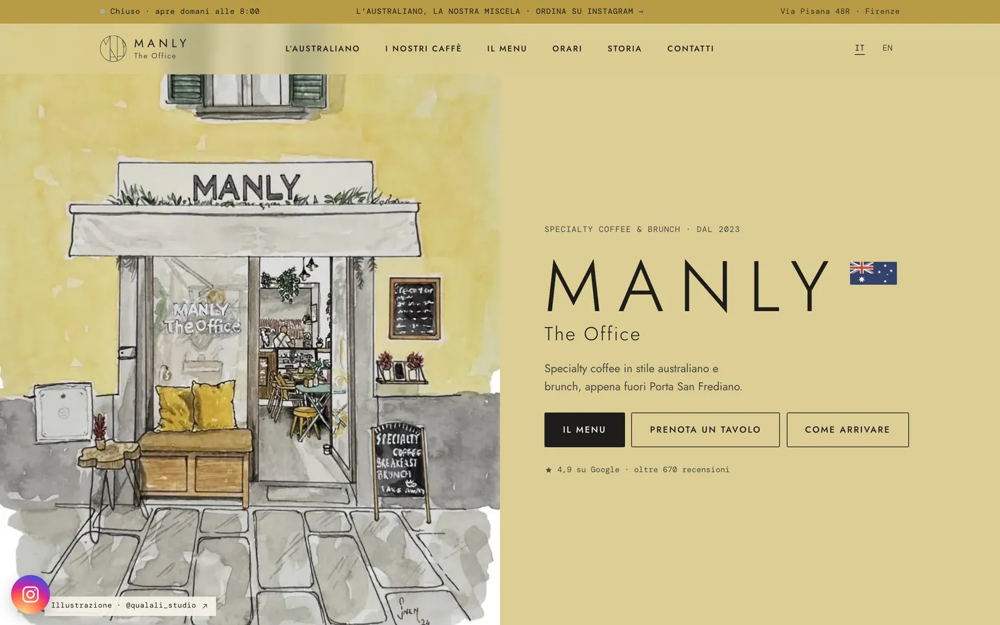
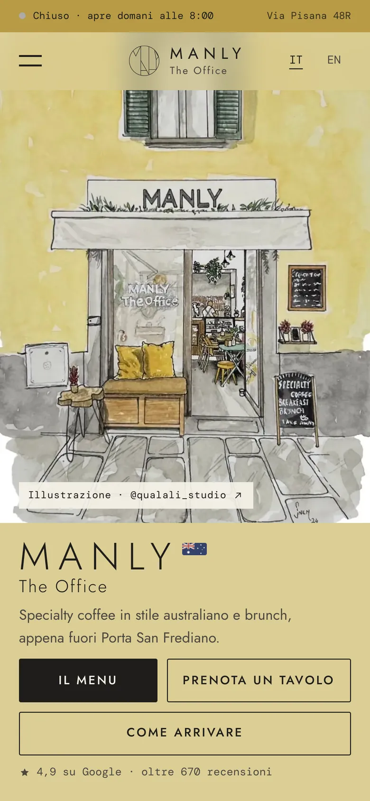
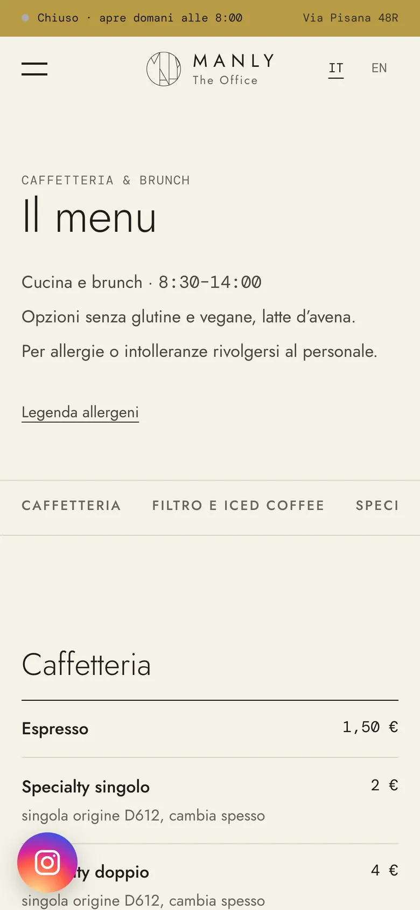

# MANLY The Office — sitio web

Sitio oficial de **MANLY The Office**, cafetería de specialty coffee y brunch de estilo australiano en Florencia
(Via Pisana 48R, junto a Porta San Frediano).

**En línea:** [manlytheoffice.it](https://manlytheoffice.it)



<p>
  
  
</p>

## El proyecto

Un local chico, sin equipo técnico, que necesitaba una web propia: que se vea como el lugar, que funcione bien en el
celular de un turista parado en la calle, y que el dueño pueda actualizar sin depender de nadie.

- **Mobile first y bilingüe (IT/EN).** Detecta el idioma del navegador, se puede cambiar con un toque y recuerda la
  elección. Los buscadores siempre la leen en italiano.
- **El dueño la actualiza desde una planilla de Google.** La carta, los cafés del día, los cierres por vacaciones, la
  nota de Google y qué secciones mostrar se editan en Google Sheets. Si Google no responde, la web usa los datos
  incluidos en el código.
- **Estado en vivo.** «Aperto · chiude alle 15:00», «Chiuso · apre domani alle 8:00», cierres especiales y horario de
  cocina, siempre con la hora de Florencia.
- **Pensada para el turista.** Tiempos a pie desde el centro (Duomo, Ponte Vecchio, Pitti…) con el recorrido en
  Google Maps, reseñas visibles y reservas por teléfono o Instagram en un toque.
- **Venta del café de la casa.** Selector de molienda y cantidad que arma el pedido y abre el chat de Instagram del
  local. El flujo está separado del proveedor, así que pasar a una pasarela de pago no cambia la interfaz.
- **Sin cookies de terceros por defecto.** Tipografías alojadas en el sitio, sin analítica, y el mapa de Google se
  carga solo si el visitante lo acepta.
- **Rápida y accesible.** Fotos en WebP con varios tamaños por imagen y JPG de respaldo, sin frameworks, sin
  dependencias en el navegador.

## Stack

| | |
|---|---|
| Front | HTML, CSS y JavaScript sin frameworks ni librerías |
| Contenido | Google Sheets publicado como CSV, con datos de respaldo en el código |
| Hosting | Cloudflare Pages (rama `produccion`) con dominio propio |
| Tipografías | Jost y DM Mono, alojadas en `assets/fonts/` |
| SEO | Datos estructurados `CafeOrCoffeeShop` y `WebSite`, Open Graph, `sitemap.xml` |

Decisiones principales:

- **Sin build de front.** La web se edita y se publica tal cual; el único paso de build (`scripts/build.sh`) copia
  los archivos públicos a `dist/`, así el README, `docs/` y `scripts/` no quedan accesibles.
- **Google Sheets como CMS.** Gratis, conocido por el dueño y sin backend. La planilla tiene instrucciones en italiano
  y listas desplegables para evitar errores de carga.
- **Contenido que se puede apagar.** Las certificaciones y los cursos del dueño dependen de él y no del local: se
  ocultan desde la planilla sin tocar el código.

## Estructura

```
index.html          inicio: portada, reseñas, L’Australiano, cafés, carta, horarios, historia, cursos, contacto
menu.html           carta completa, con alérgenos y etiquetas (vegan, sin gluten)
privacy.html        privacidad y cookies (IT/EN)
404.html            página de error
assets/site.css     estilos compartidos
assets/site.js      idioma, horario en vivo, planillas, shop, menú, consentimiento, animaciones
assets/menu.js      carta: datos de respaldo, lectura de la planilla y render
assets/fonts/       tipografías
img/                fotos (JPG + WebP en varios tamaños), video, logos
docs/               capturas, plantilla CSV de la carta, logo de referencia
scripts/build.sh    arma dist/ para Cloudflare Pages
_redirects          redirecciones de Cloudflare Pages
```

## Desarrollo local

No hace falta instalar nada:

```bash
python3 -m http.server 5173
```

Y abrir `http://localhost:5173`. Para probar el build de producción:

```bash
sh scripts/build.sh
```

**Probar estados del horario** (siempre con la hora de Florencia):

```
index.html?giorno=2&ora=14:40          día de la semana (0 = domenica … 6 = sabato) y hora
index.html?data=2026-08-12&ora=10:00   fecha concreta, para ver cierres especiales
```

## Contenido editable

### Planilla de Google

Cada pestaña está publicada como CSV y su URL está en el código. Los cambios tardan unos minutos en verse
(caché de Google). Las planillas se piden cuando la página ya terminó de cargar, para no frenar la portada.

| Pestaña | Qué controla | URL en |
|---|---|---|
| Carta | la carta completa de `menu.html` | `SHEET_CSV_URL` (`assets/menu.js`) |
| Caffè | L’Australiano, singola origine y filtro del momento | `COFFEES_CSV_URL` (`assets/site.js`) |
| Info | nota y cantidad de reseñas de Google; interruptores `certificazioni` y `corsi` | `INFO_CSV_URL` (`assets/site.js`) |
| Chiusure | cierres por vacaciones o feriados | `CLOSURES_CSV_URL` (`assets/site.js`) |

<details>
<summary>Columnas de la pestaña «Carta»</summary>

| Columna | Qué va |
|---|---|
| `sezione_id` | identificador sin espacios (`caffetteria`, `brunch`…); define el orden de las secciones |
| `sezione_it` / `sezione_en` | nombre de la sección |
| `orario_cucina` | `si` para mostrar el horario de cocina junto al título (brunch) |
| `gruppo_it` / `gruppo_en` | subtítulo opcional dentro de la sección |
| `tipo` | `piatto`, `extra` (lista al pie del grupo) o `aggiunta` (+ al plato de arriba) |
| `nome_it` / `nome_en` | nombre; si es igual en los dos idiomas, alcanza con uno |
| `descrizione_it` / `descrizione_en` | descripción opcional |
| `prezzo` | `4,5` · `4.5` · `8-12` |
| `allergeni` | números UE separados por coma: `1,7,8` |
| `etichette` | `vegan`, `senza_glutine`, `anche_senza_glutine`, `non_disponibile` |
| `titolo_extra_it` / `titolo_extra_en` | título de la lista de extras (por defecto «Extra») |

Las filas incompletas (sin sección, nombre o precio) se ignoran. Plantilla en `docs/carta-google-sheets.csv`.
</details>

<details>
<summary>Pestañas «Caffè», «Info» y «Chiusure»</summary>

- **Caffè:** tres filas fijas (`australiano`, `singola_origine`, `filtro`). Si singola origine y filtro son el mismo
  café, la web muestra una sola tarjeta para los dos usos. Sin datos, muestra «Chiedi al banco».
- **Info:** `valutazione` y `recensioni` (la cantidad se redondea hacia abajo a la decena: 671 → «oltre 670»).
  `certificazioni` y `corsi` (`si`/`no`) muestran u ocultan el recuadro de certificaciones del dueño y la sección de
  cursos de latte art, con su link en el menú.
- **Chiusure:** una fila por cierre (`Dal`, `Al`, motivo IT/EN). Esos días el estado dice «Chiuso (motivo)», y en
  «Orari» aparece un aviso desde 14 días antes.
</details>

### En el código

| Qué | Dónde |
|---|---|
| Horario, teléfono, email, Instagram | `BIZ` en `assets/site.js` |
| Textos IT / EN | `I18N` en `assets/site.js` |
| Producto del shop | `PRODUCT` en `assets/site.js` |
| Proveedor de pedidos (Instagram, WhatsApp o pasarela) | `CHECKOUT_PROVIDERS` en `assets/site.js` |
| Reseñas destacadas, prensa, tiempos a pie | `index.html` |
| Colores y tipografía | `:root` en `assets/site.css` |

### Fotos

Cada foto tiene un JPG de hasta 1080 px, un JPG de 640 px y WebP de 320, 480, 640 y 828 px y ancho completo.
En el HTML van dentro de `<picture>` con `srcset`/`sizes`, así cada pantalla descarga solo el tamaño que necesita.
Los WebP se pueden generar con [Squoosh](https://squoosh.app/) (calidad ~75).

### Caché

Los HTML cargan `assets/*.css|js?v=AAAAMMDDhhmm`. Al cambiar algo en `assets/` hay que subir ese número en las cuatro
páginas para que los navegadores descarguen la versión nueva:

```bash
V=$(date +%Y%m%d%H%M); sed -i '' -E "s#\?v=[0-9]+#?v=$V#g" index.html menu.html privacy.html 404.html
```

## Calidad

Lighthouse en móvil, sobre el sitio publicado:

| Página | Rendimiento | Accesibilidad | Buenas prácticas | SEO |
|---|---|---|---|---|
| Inicio | 74–98 ¹ | 100 | 100 | 100 |
| Menú | 100 | 100 | 100 | 100 |
| Privacy | 100 | 100 | 100 | — ² |

¹ Varía entre corridas por la ilustración de portada. ² `noindex` a propósito.

También se revisa en cada cambio que no haya desborde horizontal en celular (375 px) ni errores en consola.

## Publicación y flujo de trabajo

| Rama | Uso |
|---|---|
| `feat/*`, `fix/*` | una tarea por rama, sale de `develop` |
| `develop` | integración |
| `main` | versión estable |
| `produccion` | lo que publica Cloudflare Pages |

Flujo: `feat/*` → `develop` → `main` → `produccion`, con merges `--no-ff` y una etiqueta `vX.Y.Z` por versión.
Commits con [Conventional Commits](https://www.conventionalcommits.org/) (`feat:`, `fix:`, `perf:`, `contenido:`…).

Cloudflare Pages: build `sh scripts/build.sh`, salida `dist`. `www` redirige al dominio sin `www`, y las rutas
`.html` a las URLs limpias (`/menu`, `/privacy`).

## Créditos

- Ilustración de la portada: [@qualali_studio](https://www.instagram.com/qualali_studio/), usada con permiso.
- Fotos y video: MANLY The Office.
- Logos de Gambero Rosso y The Florentine: de sus respectivos medios, usados sin modificar para enlazar sus notas.
- Reseñas: de sus autores en Google Maps, con el texto original y el nombre abreviado.

## Pendientes

- [ ] Revisión de `privacy.html` por un profesional
- [ ] Confirmar con la cocina algunos alérgenos de la carta impresa (ver abajo)
- [ ] Fotos nuevas del brunch, hechas con cámara
- [ ] Nivel y año de la certificación SCA del dueño
- [ ] Logo en alta resolución (hoy redibujado en SVG)

<details>
<summary>Alérgenos a confirmar</summary>

La web reproduce exactamente los alérgenos de la carta impresa. Puntos a revisar con la cocina:

- **Salmon bagel** (1,7,8,9,11): lleva salmón ahumado y no figura el 4 (pesce).
- **Farmer bagel, BLT y ALT**: llevan mayonesa y no figura el 3 (uova).
- **Nocciolotto y Maple Pancakes**: la crema de avellanas suele llevar 8 (frutta a guscio).
- **Vinos y spritz**: suelen contener 12 (solfiti).
</details>

---

Diseño y desarrollo: Marco Vergara Faraon.
